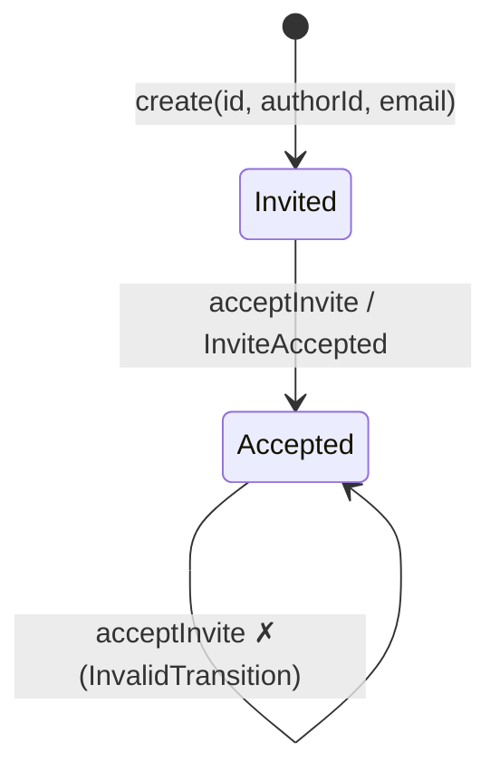

# Domain Object Patterns (TypeScript illustration — translate idiomatically)

Load when implementing or reviewing entities, value objects or transitions.

## State machine first

Tests: one per arrow (create, accept) and one per forbidden arrow (accept twice).

## Before: anemic model (refuse this)
```ts
export class PreReaderInvite {
  public id!: string;
  public authorId!: string;
  public email!: string;
  public status!: string;            // 'invited' | 'accepted' | 'acepted' | anything

  setStatus(status: string) { this.status = status; }
}

export async function acceptInvite(id: string) {
  const invite = await repo.findById(id);
  if (!invite) throw new Error('Not found');
  invite.setStatus('accepted');      // accepting twice? nobody checks
  await repo.save(invite);
  await emails.send(invite.authorId, 'Your invite was accepted'); // second state change, same process
}
```

## After: encapsulated
```ts
type DomainErrorState = { type: string; message: string };

export abstract class DomainError {
  constructor(private readonly state: DomainErrorState) {}
  getType() { return this.state.type; }
  getMessage() { return this.state.message; }
}
export class MissingValueError extends DomainError {
  constructor(property: string) { super({ type: 'MissingValue', message: `Couldn't find a value for ${property}` }); }
}
export class ValidationError extends DomainError {
  constructor(property: string) { super({ type: 'ValidationError', message: `Invalid value for ${property}` }); }
}

// Value object owns its validation
export class PreReaderEmail {
  private constructor(private readonly props: { value: string }) {}
  static create(value: string): PreReaderEmail | ValidationError {
    if (!/^[^@\s]+@[^@\s]+$/.test(value)) return new ValidationError('preReaderEmail');
    return new PreReaderEmail({ value });
  }
  getValue() { return this.props.value; }
}

type InviteStatus = 'Invited' | 'Accepted';
export type InviteAccepted = { type: 'InviteAccepted'; preReaderInviteId: string; authorId: string };

export class InvalidTransitionError extends DomainError {
  constructor(from: InviteStatus, to: InviteStatus) {
    super({ type: 'InvalidTransition', message: `Can't go from ${from} to ${to}` });
  }
}

export class PreReaderInvite {
  private events: InviteAccepted[] = [];
  private constructor(private props: PreReaderInviteState) {}

  static create(input: PreReaderInviteInput): PreReaderInvite | DomainError {
    const presence = Guard.againstNullOrUndefined(input, ['preReaderInviteId', 'authorId', 'preReaderEmail']);
    if (presence.hasErrors()) return presence.getFirstError();

    const id = PreReaderInviteId.create(input.preReaderInviteId);
    const authorId = AuthorId.create(input.authorId);
    const email = PreReaderEmail.create(input.preReaderEmail);

    const validity = Guard.againstValidationErrors([id, authorId, email]);
    if (validity.hasErrors()) return validity.getFirstError();

    return new PreReaderInvite({
      preReaderInviteId: id as PreReaderInviteId,
      authorId: authorId as AuthorId,
      preReaderEmail: email as PreReaderEmail,
      inviteStatus: 'Invited',
    });
  }

  acceptInvite(): InvalidTransitionError | undefined {
    if (this.props.inviteStatus === 'Accepted') return new InvalidTransitionError('Accepted', 'Accepted');
    this.props = { ...this.props, inviteStatus: 'Accepted' };
    this.events.push({
      type: 'InviteAccepted',
      preReaderInviteId: this.props.preReaderInviteId.getValue(),
      authorId: this.props.authorId.getValue(),
    });
    return undefined;
  }

  getInviteStatus(): InviteStatus { return this.props.inviteStatus; }
  getEvents(): readonly InviteAccepted[] { return [...this.events]; }
}
// The email context reacts to InviteAccepted through the event bus, not inside this call.
```

## Guard helper (grow it only when needed)
```ts
export class GuardResult {
  constructor(private readonly errors: DomainError[]) {}
  hasErrors() { return this.errors.length > 0; }
  getFirstError() { return this.errors[0]; }
}

export class Guard {
  static againstNullOrUndefined(data: Record<string, unknown>, keys: string[]): GuardResult {
    const missing = keys.filter((key) => data[key] === null || data[key] === undefined);
    return new GuardResult(missing.map((key) => new MissingValueError(key)));
  }
  static againstValidationErrors(items: unknown[]): GuardResult {
    return new GuardResult(items.filter((i): i is ValidationError => i instanceof ValidationError));
  }
}
```

## Tests: one describe per transition
```ts
describe('PreReaderInvite', () => {
  describe('create', () => {
    it('creates an invite that starts out invited', () => {
      const invite = PreReaderInvite.create(validInput) as PreReaderInvite;
      expect(invite.getInviteStatus()).toBe('Invited');
    });

    it.each([
      [{ authorId: AUTHOR_ID, preReaderEmail: 'reader@example.com' }, 'preReaderInviteId'],
      [{ preReaderInviteId: INVITE_ID, preReaderEmail: 'reader@example.com' }, 'authorId'],
    ])('knows an invite without %s is invalid', (input, property) => {
      const error = PreReaderInvite.create(input as PreReaderInviteInput) as DomainError;
      expect(error).toBeInstanceOf(MissingValueError);
      expect(error.getMessage()).toContain(property);
    });
  });

  describe('acceptInvite', () => {
    it('moves an invited invite to accepted', () => { /* state verification */ });
    it('knows an accepted invite cannot be accepted again', () => { /* forbidden arrow */ });
    it('records exactly one InviteAccepted event', () => { /* call twice, one event */ });
  });
});
```

## Aggregate per command (keep them small)
```ts
class Email { constructor(readonly value: string, readonly status: 'verified' | 'not-verified') {} }
class UserForCreateUser { email: Email; password: Password; }
class UserForEditUser { id: UserId; firstName: FirstName; lastName: LastName; email: Email; }
// Only after the rule of three: extract a shared User type.

class PlaylistItem {                     // reordering touches pointers, not every item
  constructor(public readonly id: string, public previous: string | null, public next: string | null) {}
}
```
