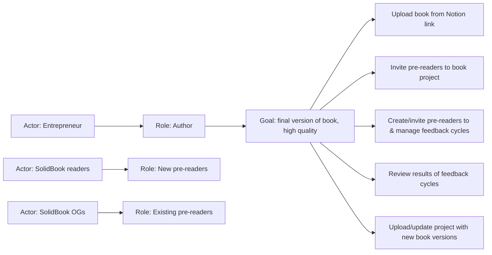

# Lesson 66 — Demo: FeedBook — Find the Subdomains (from the Design Story, Concrete Examples, Domain Knowledge)
- **Source file:** 66) Demo FeedBook — Find the Subdomains (from the Design Story, Concrete Examples, Domain Knowledge).txt
- **Category:** theoretical-ddd
- **Topics:** problem-guess-point, impact-mapping, actor-role-goal-capabilities, feature-injection, user-story-mapping, responsibility-driven-design, concrete-examples, design-story, domain-knowledge, glossary, conceptual-model, subdomains, core, supporting, generic, bounded-contexts, category-theory, FeedBook

## Summary
Live demo at the **problem guess point** for FeedBook, Khalil's product for authors to run feedback cycles with pre-readers on a book in progress. The problem guess point should produce four things: what the problem is, a few concrete examples (the most valuable ones), domain knowledge, and clear subdomains. Khalil uses his own version of impact mapping (actor → role → goal → capabilities/features). It stays on the *what* and *why* and leaves the *how* for the solution guess point. Domain knowledge (facts, glossary) gets pulled out of domain experts' heads and written down. The session ends by brainstorming every category of problem involved in running FeedBook. Those raw, ungrouped categories are the **subdomains**. Grouping them into bounded contexts is left for the solution space.

## Core ideas
- Problem guess point outputs: (1) know the problem, (2) some concrete examples (most valuable ones), (3) domain knowledge, (4) clarity on subdomains.
- Many techniques can get you clarity on the problem. Which one you use doesn't matter as long as you end up clear on the features needed to reach a desirable end result.
- **Impact mapping** puts the impact front and center: why you're doing the work, the goal, who's involved and who benefits. It protects against building things that "just don't matter."
- Khalil finds the standard impact-map diagram ("Grow mobile advertising", "super fans"...) "a little bit backwards". He prefers starting with **role and goal**.
- Get clear on the **what** and **why** and leave the **how** for later. Some features may become clear, but you don't go deep. Working out how a feature is built belongs to the next step, the **solution guess point**.
- "Design is just really all about abstraction, separating the what from the how." Everything at this stage describes behavior, not implementation.
- Naming actors and roles early lets you drive goals for real people, which is easier than driving them for abstract ones.
- The feature list is "a very general high level experience of using a platform to get to this goal."
- It isn't the only possible solution. An alternative is to collect emails of people who bought the book and email back and forth, which isn't a fun experience. A platform gives back or enriches time, and that creates value (chat answer; "value" inferred).
- His method is "my mishmash" of impact mapping, feature injection, responsibility-driven design, and a bit of user story mapping.
- From each feature you can create a concrete example or real design story (e.g. a design story of Khalil uploading the book), then move on.
- **Domain knowledge** comes out of the collaborative process. For the assignments, Khalil acts as the domain expert and students should ask him "what happens if…" questions.
- Open questions are normal. Example: "What are the results of feedback cycles going to be? What should they be able to see?" Khalil had no answer yet. Wireframing or talking to real authors would help.
- Start a **glossary / domain knowledge document** of facts, e.g. "a feedback cycle is…", "a feedback cycle has…".
- Reason to write it down: you're building a **conceptual model** (not a real one yet), and it's all abstract. If a consultancy parts ways with the client halfway through, the knowledge should be saved in documents.
- Domain knowledge questions: What is true of this metaphysical reality you're creating? What isn't quite true? How do things interact? What belongs where? What needs to happen before what?
- Domain knowledge is "locked in the domain experts' heads". Extract it onto the page.
- Moving from the problem guess point down to the physical, things become less abstract and more real.
- The FeedBook subdomain brainstorm shows "this is actually a very complex problem to solve."
- First step: "just lay out. Just get as much as you can out of your brain". Get the major categories of problems onto the page.
- You're done with subdomains when the list is exhausted and you can't think of more categories you'd need to solve the problem.
- Next step (solution space): turn subdomains into **bounded contexts**.

## Named frameworks / mental models
- **Problem guess point**
  - Purpose: understand the problem before designing the solution.
  - Outputs: problem clarity, concrete examples, domain knowledge, subdomains.
  - When: first theoretical guess point, before the solution guess point.
- **Impact mapping (Khalil's variant): Actor → Role → Goal → Capabilities (features)**
  - Purpose: tie work to impact and real people, and get clear on what/why without the how.
  - Steps: list actors, then their roles, then each role's goal, then the capabilities/features needed to reach it.
  - When: start of a project or feature, to avoid building things that don't matter.
  - Mixes in feature injection, RDD, and user story mapping.
- **Feature → concrete example / design story**: each feature can be turned into a concrete example before moving on.
- **Domain knowledge glossary / facts document**: written facts about the conceptual model.
- **Subdomain types**: core, supporting, generic (see Definitions).
- **Brain-dump categorization**: get all categories of problems out of your head, then group them later (category theory, abstraction, cohesion).

## Definitions
- **Impact mapping** — technique that puts the impact front and center: why you're doing what you're doing, the goal, who's involved, and who benefits.
- **Domain knowledge** — facts about the (metaphysical/conceptual) reality you're creating: what's true, what isn't, how things interact, what belongs where, what happens before what. It's locked in domain experts' heads.
- **Conceptual model** — the abstract model built during design, "not a real one yet".
- **Subdomain** — whatever category of the problem comes straight to mind. These are parts of the problem that could be solved, with no solid grouping, and they can be big or tiny.
- **Core subdomain** — what makes your business unique (student answer, Khalil agrees).
- **Generic subdomain** — something you can pay an external service to do (student answer, Khalil agrees).
- **Supporting subdomain** — not related to the problem you're *currently* solving (the business may be in a phase where the most valuable thing now differs from later). You still need to build it yourself rather than buy it off the shelf, because it's strategic. Examples: reporting (though reporting software exists), and Google Calendar possibly building scheduling itself.
- **Bounded context** (preview) — Khalil would call granular pieces like "delivery, shop" (a student's subdomain examples) bounded contexts. The line is "incredibly subjective" and there's no right answer.
- **Domain (FeedBook)** — the big problem: "literally everything involved in me operating this business."

## Rules & heuristics
- Leave the *how* for the solution guess point. Focus the problem guess point on behavior (what) and purpose (why).
- Start impact mapping from actors and roles so the goals are for real people.
- It doesn't matter how you get there, as long as you end up clear on the features required for a desirable end result.
- Build concrete examples from the features, prioritizing the most valuable ones.
- When you hit unknowns (e.g. what feedback-cycle results should show), use wireframes or talk to real users/domain experts.
- Record domain facts in a glossary or document so knowledge survives handoffs.
- For subdomains, brain-dump every category and don't worry about size or grouping yet.
- Stop when the list is exhausted, then group into bounded contexts in the solution space.

## Anti-patterns / mistakes called out
- Building things that "really just don't matter" with no clear impact or goal.
- Jumping into the *how* (implementation) during problem discovery.
- Leaving domain knowledge only in heads or undocumented, so it's lost when a team or consultancy changes hands.
- Treating neat granular splits (delivery, shop) as subdomains. Khalil sees those as bounded contexts, and real subdomains are rarely that neatly granular.

## Code discussed
None (design artifacts only; see tables below).

### FeedBook impact map
| Actor | Role(s) | Notes |
|---|---|---|
| Entrepreneur | Author | Khalil himself; the goal is a final version of the book that is "desirable, effective, something else" (third quality not remembered) |
| SolidBook readers | Pre-readers → **new pre-readers** | readers invited to give feedback |
| SolidBook OGs | **existing pre-readers** | people who have already read Khalil's book |

**Goal (Author):** get a final version of the book written with high quality (desirable, effective, …).

**Capabilities / features:**
1. Upload the book (create a project) from a Notion link ("a whole ass feature").
2. Invite pre-readers to join the book project.
3. Create and invite pre-readers to, and manage, feedback cycles.
4. Review the results of feedback cycles.
5. Upload and update the project with new book versions.
6. (Maybe) run more feedback cycles.

**Alternative (non-platform) solution considered:** collect book buyers' emails and email back and forth. Rejected as not fun. The platform gives back or enriches time, which creates value.

### FeedBook subdomain brainstorm (raw, ungrouped)
| Subdomain (as named) | Origin / reason |
|---|---|
| Notion integration | upload book from Notion link |
| Book parsing / text parsing | parsing the uploaded book |
| Project source | chat suggestion (not elaborated) |
| Pre-readers / pre-reading | core activity |
| Users & sign-up / registration ("Investration" [sic]) | chat |
| Users and identity | "for sure" |
| Invitations / invites | inviting pre-readers |
| Feedback cycles | core activity |
| Scheduler / scheduled jobs / scheduling | feedback cycles happen on a scheduled basis |
| Payments | authors could use it → paid product |
| Credit card management ([Tenant card management]) | follows from payments |
| Pre-reading sessions | want to know how long a reader is on a page and when they leave |
| Browser sessions | same |
| Emails | invitations |
| Book feedback / Feedback | leaving feedback on the books |
| Emoji / emoji management | feedback is left via emojis |
| Versioning (of the book) | new book versions |

## Diagrams / visual models described
- **Guess-point map** (Miro/whiteboard): problem guess point → solution guess point → … down to physical. Abstract at the top, more physical going down. The current position is marked at the problem guess point.
- **Impact map board**: Actor → Role → Goal → Capabilities, as boxes left to right (Khalil's ordering). Mermaid sketch (reconstructed):

- **Features copied next to the guess-point checklist**, with arrows showing "a concrete example can be created from each feature."
- **Domain box "FeedBook"** with the subdomain stickies scattered inside it, ungrouped.

## Notable quotes
- "We want to know what it is we're building. We want to know why we're building it. But we don't really care about how we're going to build it just yet."
- "Design is just really all about abstraction, separating the what from the how."
- "It doesn't matter how you get here, but you need to get to the point where you have clarity on the features you need to build."
- "What is true of this metaphysical reality you're creating? What is not quite true? How do these things interact? What belongs where?"
- "It's locked in the domain experts' heads. And what you could begin to do is to extract some of it out and get it on the page."
- "Just get as much as you can out of your brain. What are the major categories?"
- "They're parts of the problem that could be solved. They don't really have a solid grouping to them."

## Cross-references
- Lesson 21 (Value Identification): what/why/who and value creation.
- Lesson 22 (Domain Discovery): subdomains, solution guess point, event storming.
- Lesson 23 (Strategic Design): core/supporting/generic, build vs buy.
- Lesson 14 (Abstraction): what vs how.
- Lesson 38 (RDD), part of the "mishmash".
- Lesson 65 (Intro to Theoretical Guess Points).
- Lessons 67–68: bounded contexts and consolidation continue this demo.

## Fluff skipped
Discord notification fiddling, a tangent about a tough networking professor who bet on IPv4, and a repeated "cliffhanger" transcription loop at the end.

## AI-era relevance hint
- AI agents write the *how* quickly. A human still has to pin down the *what/why/who* (impact map) or the agent builds features that "don't matter."
- A written domain glossary/facts doc is good context to give coding agents and keeps naming consistent across generated code.
- Brain-dumping subdomains early shows where to buy (generic) and where agent effort should go (core).

## Coverage proof
- Lines read: 112 / 112
- Final line (verbatim): "cliffhanger here. I left me. I left Pointe. I left the cliffhanger there. I left it. I left. I left. I left. I'm coming here. Yeah. I left. I left. I left."
