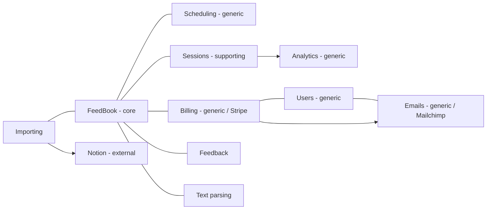

# Lesson 68 — Demo: FeedBook — Consolidating Subdomains Into Bounded Contexts
- **Source file:** 68) Demo FeedBook — Consolidating Subdomains Into Bounded Contexts.txt
- **Category:** theoretical-ddd
- **Topics:** bounded-contexts, subdomains, core, supporting, generic, build-vs-buy, responsibility-gaps, context-mapping, modular-monolith, package-by-domain, package-by-infrastructure, single-responsibility-principle, ts-arch, dependency-rule, customer-supplier, upstream-downstream, events, state-machines, sagas, temporal-decoupling, design-it-twice, FeedBook

## Summary
Khalil clones the FeedBook subdomain board and groups the stickies by shared language into **bounded contexts**. He labels each one core, supporting, or generic, which decides whether you build it, buy it, or must build it because no tool fits. A key rule: always have one bounded context that represents your actual product. For FeedBook this is the core context, named **FeedBook**. The bounded contexts map directly onto a **package-by-domain** folder structure inside a **modular monolith**. Package-by-infrastructure (controllers/routes/models) is called out as an anti-pattern, and SRP is reframed at the problem level. He then makes a first-pass **context map** and explains that the relationships between contexts are really **events**. Context maps are the foundation for state machines, sagas, and temporal decoupling. He argues the dependency rule doesn't apply between contexts, using a Stripe webhook example.

## Core ideas
- Concrete examples were missed in the previous lesson and are still needed. Write them as Given/When/Then or as user stories; the format doesn't matter.
- A concrete example needs: the **starting state**, the **ending state**, what the person does, and what they should see. "If we're getting really fancy", also what they experience and how they feel about it (value).
- Consolidation process: clone the domain board and start grouping subdomains into categories.
- "This is all language. So it's language and it's crunching language." That's why it's hard.
- **Add rather than take away** information while grouping (e.g. add "Google integration" next to Notion instead of dropping ideas).
- Chat definition Khalil likes: subdomains are things needed for your app, and bounded contexts are categorizations of those subdomains.
- Khalil's extension: a bounded context is "placing a boundary around the context of language that is allowed to be used within a sphere of the domain of that problem or knowledge space."
- Grouping surfaces new language. In Feedback: feedback is left on chapters, there are emoji **reactions** ("the concept of a reaction just emerged"), comments on lines, and comments on entire chapters. The verbs are *posting a comment* and *posting a reaction*.
- Classification leads into **build vs buy**: "how you find and fill these responsibility gaps and how you determine what you want to be an external service and what you want to build yourself and how you vet libraries and frameworks."
- Tangent on frontend frameworks (e.g. choosing Next.js): start at the problem guess point, get clear on needs like SSR, get clarity on subdomains, then find tools that fill those gaps.
- When no off-the-shelf tool plugs and plays (Sessions), you're forced into **responsibility-driven design / object design** to fill the gap yourself. That makes the context **supporting**.
- Each bounded context later gets assigned an implementation: an external service or our own codebase.
- Architecture: start with a **modular monolith**, designed so it can be split into multiple deployable units later. Covered more under bootstrapping and composition at the system guess point.
- There's one folder per bounded context. External-service contexts (e.g. scheduling) get a thinner folder but still hold integration logic and domain concepts, kept separate from others (e.g. from sessions). "That is the concept of coupling."
- A useful exercise for later in the course: take a messy real project, identify the current contexts (problem space), and see how each is currently being done.
- **SRP at problem/solution level**: a single bounded context for a single subject with clear responsibilities. At class level: a class with cohesive responsibilities.
- "Architecture is not technology." / "Architecture does not equal technology."
- **Always have one bounded context representing your actual domain** (the feature/app you're building). It's **core**: "the unique new stuff that matters that you can't get anywhere. You can only get here." For FeedBook it's named **FeedBook**.
- Parsing split: *knowing how to parse the book* goes in the books/FeedBook area, but *actually parsing* goes in **text parsing** ([transcript: "Quick parsing logic"], likely "book parsing logic").
- Importing: Khalil will probably have to build at least parts himself. Parts can be broken out (text parsing; Notion API = generic/external). It might be renamed "data sources" or "book sources" later but is left as is ("good enough").
- Team adoption (Q&A):
  - Daniel: you travel across four different folders to work on one feature (in tech-first structures).
  - Commenter: changing a team's framework conventions will anger people, so get buy-in first. Khalil agrees the structure must be well established with the team.
  - **TS-Arch** (ts-arch) was found in the community. It lets you define tests for folder structure and architecture rules, e.g. inner-layer concerns (value objects, entities) aren't allowed to know about Express controllers or DB models.
  - Influence: argue from **first principles**, point to what experts do, and **ask questions** so people reach their own conclusions. Khalil: "None of this stuff I'm teaching… I've personally just discovered myself."
  - Tech-first conventions (e.g. Angular's) serve you well at the beginning and code-first. Once projects accrue many capabilities they complicate things. Structure the code closest to the **essence of the hard problem**.
  - Answers to folder structure appear "way up in the abstract, theoretical, metaphysical space before we even touch code." Khalil: "that's truth enough."
- Recap: subdomains (problem space) → "be Aristotle", group by shared language → bounded contexts → each one gets built, bought off the shelf, or must be built because it's specific.
- Leftover consolidation: Book feedback + emoji management → **Feedback**, and "feedback cycles should also be a part of that". Pre-reader / pre-reading / pre-readers / **authors** probably go in the same (FeedBook) group (inferred from "that's probably going to go in here as well").
- This is finicky. People who struggle with English or creative thinking will struggle with this task.
- **Design it twice**: the course structure itself is an example. Redesigning showed where sections belong, and upfront design seen "in a new light" yields different solutions.
- **Context mapping**: understand the conversations between contexts. Full clarity comes at the next step (process mapping / event storming). Doing things slightly out of sequence doesn't matter as long as you move on with everything clear.
- Context-map question: "What relies on what?" If you know two things are related but not the direction, that's "good enough for now".
- Context maps are "the foundation to you understanding the state machines" and the foundation for **sagas** and **temporal decoupling**.
- What really links contexts is **events**. Example: when a feedback cycle is scheduled/created, Scheduling listens to that event, creates a **Job**, and that starts the **Job state machine**.
- Q: Should the dependency rule apply here (core context shouldn't depend on others)? Khalil doesn't think so, because sometimes it's unavoidable.
  - Example: your business relies on webhooks. A customer's credit card expires after two months, you want to be alerted, Stripe sends you the event, and you adjust their account.
  - DDD names such relationships **customer–supplier** and **upstream/downstream**, with more on the context-mapping cheat sheet (shared in chat). "Sometimes you don't really have a choice."
  - Dependency rule (restated): a concern in a higher policy layer (domain) shouldn't depend on lower-level details. E.g. a value object or entity shouldn't rely directly on a repository or the console.
  - Khalil's model of systems: "a network of systems talking to each other" through events. Companies work the same way.

## Named frameworks / mental models
- **Subdomain → bounded context consolidation**
  - Steps: clone the board → group by shared language ("be Aristotle") → add rather than remove → label each group → classify it as core, supporting, or generic → decide build, buy, or must-build → context map.
- **Core / Supporting / Generic assessment (build vs buy)**
  - Generic: don't want to build it and a service exists (Stripe, Mailchimp, Mixpanel-like analytics, a scheduling service).
  - Supporting: needed, but no tool plugs in nicely, so you fill the responsibility gap with RDD/object design (Sessions).
  - Core: your unique product, which must be built (FeedBook).
- **One core context rule**: always have one bounded context that represents your actual domain.
- **Package by domain** (also called package by domain feature or context module) vs **package by infrastructure**.
- **SRP at problem level**: one bounded context per subject, with clear responsibilities.
- **Modular monolith first**, splittable into deployables later.
- **Context mapping**: draw what relies on what; relationships are events; customer–supplier and upstream/downstream patterns.
- **Systems as a network of event-emitting systems.**
- **Design it twice.**

## Definitions
- **Bounded context** — a categorization of subdomains. It places a boundary around the context of language allowed within a sphere of the domain/knowledge space.
- **Context mapping** — drawing the relationships (conversations and dependencies) between bounded contexts.
- **Package by infrastructure** — folders like `controllers/`, `routes/`, `models/` (frontend: just `components/`). "Generally bad."
- **Package by domain / domain feature / context module** — one folder per bounded context.
- **SRP (problem/solution level)** — a single bounded context for a single subject with clear responsibilities. **SRP (class level)** — a class whose responsibilities are cohesive.
- **Dependency rule** — a concern in a higher policy (domain) layer shouldn't depend on lower-level details (e.g. a value object/entity shouldn't rely directly on a repository or the console).
- **Customer–supplier / upstream–downstream** — DDD context-mapping relationship types.

## Rules & heuristics
- Group subdomains that share language. When similar but the domain is really about one of them, keep them separate (feedback cycles ≠ scheduling).
- Add information while consolidating rather than deleting it.
- Ask whether you actually want to build all of it (e.g. jobs, failed jobs, retries, completions). If not, the context is a generic candidate.
- Use an external service for generic contexts. Build supporting contexts only when no tool plugs and plays.
- Always keep one core context named after the product.
- Keep an external-service context's logic in its own folder, separate from other contexts.
- For framework/library choices, list subdomains/needs first and then choose tools to fill the gaps.
- Get team buy-in before changing folder conventions. Enforce structure with tools like TS-Arch.
- Persuade with first principles, expert precedent, and questions.
- A related-but-direction-unknown context link is fine on a first pass. Event storming clarifies it.
- Model inter-context links as events. Don't force the dependency rule between contexts.

## Anti-patterns / mistakes called out
- **Package by infrastructure** (`controllers/`, `routes/`, `models/`, or frontend `components/` only): "just know you're screwed". It means little cohesion, lots of coupling, and no clean boundaries between areas that change for their own reasons.
- Having to travel across four folders to work on one feature (Daniel's comment).
- Tech-first conventions on projects that have grown many capabilities.
- Imposing new folder conventions on a team without buy-in.
- Building generic capabilities yourself (billing, emails, scheduling, analytics) when services exist.
- Arguing "this is just subjectively better" instead of from first principles.

## Code discussed
No code. Folder structure described:
```text
// reconstructed from narration — package by domain (modular monolith)
src/
  sessions/        # only session-related things
  feedback/
  books/
  integrations/    # (later: importing)
  scheduling/      # thinner; external service does most work, but keep its logic/domain concepts separate
  ...
```
vs anti-pattern:
```text
src/
  controllers/
  routes/
  models/
```
TS-Arch-style rule mentioned: inner-layer concepts (value objects, entities) must not import Express controllers or database models.

### Consolidation moves (subdomain → bounded context)
| Subdomain(s) | Reasoning | Bounded context |
|---|---|---|
| Payments + credit card management | similar enough | **Billing** (name from chat) |
| Scheduling / scheduler / jobs | unique; jobs, failed jobs, completed jobs, retries | **Scheduling** |
| Feedback cycles | similar to scheduling, but "my domain is specifically about feedback cycles" → keep separate | FeedBook (core) / Feedback |
| Browser sessions + pre-reading sessions | a thing of its own; also involves "the browser" | **Sessions** |
| Pre-reading data | tracking reader interaction | **Analytics** |
| Pre-reading, invitations ("invitation for pre-reading") | converges with the actual domain | FeedBook (core) |
| Book feedback + emoji management | same language; feedback is done in a session | **Feedback** (reactions, comments on lines/chapters) |
| Versioning | the book is what's versioned | **Books** (books + versions together) |
| Emails | off the shelf | **Emails** |
| Notion integration + book parsing (+ maybe Google integration) | related: parse book from source | **Integrations** → renamed **Importing**; parsing split into **Text parsing** |
| Notion API | external | **Notion** (external service / generic) |
| Users & identity | account concerns | **Users** (generic) |
| Pre-reader, pre-readers, authors | domain actors | FeedBook (core) (inferred) |

### Classification & implementation
| Bounded context | Type | Implementation |
|---|---|---|
| FeedBook | Core | our codebase ("you can only get here") |
| Scheduling | Generic | external service ("really don't want to build") |
| Analytics | Generic | external service (Mixpanel or similar) |
| Billing | Generic | Stripe |
| Emails | Generic | Mailchimp |
| Sessions | Supporting | build ourselves (RDD/object design); no plug-and-play library known |
| Importing | Supporting (inferred: "probably have to build this myself", at least parts) | own code + Notion API |
| Notion (API) | Generic | external service |
| Users | Generic (named generic in lesson 69) | — |
| Feedback / Books / Text parsing | not explicitly classified | — |

### First-pass context map (relationships)
| From | To | Relationship |
|---|---|---|
| Emails | Users | related; direction unknown |
| Billing/payments | Emails | after payment happens, send an email |
| Sessions | Analytics | analytics comes from sessions (how readers interact with feedback cycles) |
| Sessions | Feedback cycles (FeedBook) | related |
| Feedback (cycles) | Scheduling | scheduling feedback cycles; e.g. "feedback cycle scheduled/created" event → Scheduling creates a Job (Job state machine starts) |
| Billing | Users | usually related via sign-up |
| Billing | Feedback | maybe bill per feedback cycle or per hits/feedback |
| Books/FeedBook | Text parsing | knowing how vs actually parsing |
| Importing | Notion | uses external Notion API |
| FeedBook / Billing | Stripe | e.g. credit-card-expired webhook event → adjust account (customer–supplier / upstream–downstream) |

## Diagrams / visual models described
- **Cloned domain board**: subdomain stickies dragged into clusters, each circled and labeled with its bounded-context name.
- **Circles classified** with core/supporting/generic tags and implementation notes (Stripe, Mailchimp, analytics tool, our code base).
- **Folder structure sketch**: package-by-domain folders vs a `controllers/routes/models` tree.
- **Context map**: lines between circles (Emails–Users, Sessions–Analytics, Sessions–Feedback cycles, Feedback–Scheduling, Billing–Users, Billing–Feedback). Khalil redraws a few because it "looks a little bit messy." A "Next steps" note reads: context map; make sure we have all the cores.
- **DDD context-mapping cheat sheet** shown (customer–supplier, upstream/downstream).
- Mermaid sketch (reconstructed):


## Notable quotes
- "This is all language. So it's language and it's crunching language."
- "You're placing a boundary around the context of language that is allowed to be used within a sphere of the domain."
- "Single bounded context, with clear responsibilities."
- "Architecture is not technology."
- "You always want to have one bounded context that represents your actual domain."
- "Having an awareness of the context maps between these bounded contexts, this is the foundation to you understanding the state machines."
- "It's just a network of systems talking to each other."
- "Design it twice."

## Cross-references
- Lessons 66–67 (subdomains; bounded contexts and cohesion).
- Lesson 69 (event storming), which refines the context map.
- Lesson 18 (Temporal Decoupling): sagas, events.
- Lesson 19 (Composition), Lesson 24 (Walking Skeleton): bootstrapping, deployables.
- Lesson 23 (Strategic Design): build vs buy.
- Lesson 35 (Structure Codebases), Lesson 37 (Clean/Layered Architecture): dependency rule, stereotypical architecture.
- Lesson 38 (RDD): filling responsibility gaps.
- Lesson 74 (State Machines).

## Fluff skipped
Discord notification fixing, freeCodeCamp banter (and the backpack story), and "silence is acceptance" filler.

## AI-era relevance hint
- Build-vs-buy per context is a human strategic call. Agents will happily hand-roll billing or schedulers unless told the context is generic.
- Package-by-domain plus TS-Arch-style rules give agents machine-checkable boundaries, so they can't sneak infra imports into the domain.
- A context map of event flows is the high-level spec agents need to wire modules correctly without tight coupling.

## Coverage proof
- Lines read: 222 / 222
- Final line (verbatim): "any questions? Silence is acceptance. I guess it is. No questions. All right. Fair enough."
