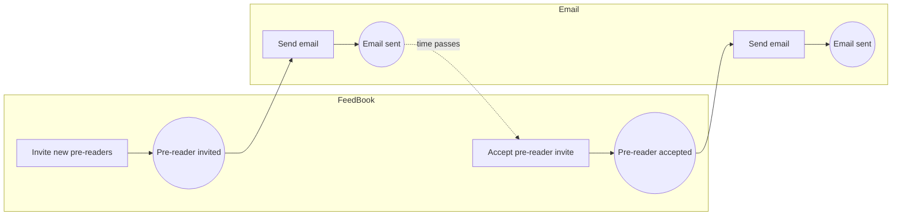
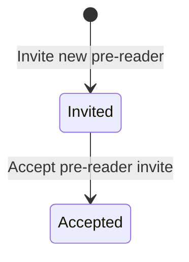

# Lesson 69 — Demo: FeedBook — Event Storming (Process Modelling) a Concrete Example
- **Source file:** 69) Demo FeedBook — Event Storming (Process Modelling) a Concrete Example.txt
- **Category:** theoretical-ddd
- **Topics:** event-storming, process-modelling, solution-guess-point, concrete-example, given-when-then, user-stories, domain-events, commands, actors, aggregates, bounded-contexts, state-machines, temporal-decoupling, event-driven-architecture, naming, FeedBook, pre-reader-invite

## Summary
At the **solution guess point**, Khalil writes a Given/When/Then concrete example for the FeedBook feature "create and invite pre-readers to and manage feedback cycles". Specifically, an author bulk-invites three pre-readers and only Sally accepts. He then event-storms it in this order: **domain events**, then **commands** (the imperative of each event), then **actors**, then **aggregates**, then **bounded contexts**. The first model has a "pre-reader invite accepted" event in FeedBook that triggers "create pre-reader account" in the same context. That smell leads him to a state-machine redesign: a pre-reader is created in the `Invited` state and moves to `Accepted`, so the separate invite-to-account step disappears. The rule of thumb: be wary of domain events within the same context that change the same concept. Event storming (process modelling) gives the most clarity on data, behavior, relationships, and process.

## Core ideas
- Start with the event storming cheat sheet. The first thing to do is get the **story / concrete example**: what are we trying to validate?
- Format: Given/When/Then (a user story "As a… so that…" also works). Khalil asks how students write stories.
- Feature chosen: "Create and invite pre-readers to and manage feedback cycles." Scenario named **"Inviting pre-readers to the platform"** (see Code discussed).
- A use case or user story can be as long as you want and "could span quite a distance" (Alistair Cockburn's book, [transcript: "Alistair Copper"]). This scenario goes a bit beyond one feature to be interesting enough to model.
- With a clear beginning and end, the first event-storming step is **domain events**. Order doesn't matter yet: "just get these events set up… out of our head… so that we can order them."
- **Consolidate language** as you go ("Invite sent" / "Invite accepted" → "Pre-reader invite …").
- Remodel based on a question from chat: the invite being sent and the email being sent are separate, giving "Pre-reader invite created" → "Email sent".
- Commands pattern: events are written in **past tense**, and commands are the same phrase in the **imperative** ("Pre-reader invite created" → "Create pre-reader invite").
- It's worth "really criticizing this language here" because it's the language that will be used in the code.
  - Could "pre-reader invite" just be "invite"? Could "pre-reader account" just be "pre-reader"?
  - Bashman: assign a pre-reader status to an already registered user rather than creating another account. Khalil: *User* belongs to the generic Users bounded context, which is different from *Pre-reader*, which belongs to FeedBook. He's "not too mad" at the current naming. "Things will emerge," and that's where state-machine modelling comes in to expose weird inconsistencies.
- Next step: **actors** or **aggregates** (either is fair). Khalil does actors, then the data (aggregates), then bounded contexts last.
- "Who does send email?" The **System**, not a person. After the pre-reader accepts, the System does the follow-ups automatically: "because this is event based… you're working with an event driven architecture."
- Is "pre-reader" an actor or a role? "It's a funky thing." It's used as the actor.
- **Aggregates** = "the data that we're doing work against."
- **Bounded contexts**: the work was done upfront, so "all we have to do is just place the boundaries around these properly."
- **Design smell** spotted: accepting the invite and then creating the pre-reader account within the same process and context. "Whenever I see this relationship here, I don't really love this."
- Fix via **temporal decoupling** and state machines: create the pre-reader when invited, with an initial state. A pre-reader can't come into being without being invited, so the separate "create pre-reader account" step disappears. "Some simple naming changes."
- Domain rules can be annotated on the board as sticky notes, e.g. "In order to create a pre-reader, they start out invited."
- Naming: considered "Accept invite" (nice language) but kept **"Accept pre-reader invite"**, "keep it specific for now."
- **Rule of thumb**: when domain events occur within the same context and change the same concept, be very wary. You might be missing a state change or have modelled the state changes wrong.
- Events that cross contexts make sense. Between contexts, events are listened to by the other context, and **time passes** (the pre-reader accepts "whenever they feel like it").
- State machines are included as an assignment because they show how data moves. "The hardest thing at this level is just knowing how to design these correctly": when something gets created and what its initial state is.
- Recap: at the solution guess point, we wrote a concrete example (forgotten at the problem guess point) in Given/When/Then, and broke the domain into bounded contexts first, so they could simply be placed during event storming. Finding bounded contexts is often the hardest part.
- Suggested reordering: find core/supporting/generic domains first and do the process model last. The process model is "probably the most key part." It gives ultimate clarity on the **data, behavior, relationships, and process**, which all need to be codified in the domain model.
- Khalil: the solution guess point is one of his favorite parts of any project.

## Named frameworks / mental models
- **Event storming / process modelling (as run here)**
  - Purpose: model the process of a concrete example to find language, data, behavior, and boundaries for the domain model.
  - Steps: (0) concrete example (GWT) with a clear start and end → (1) domain events, past tense, unordered, then ordered → (2) commands, the imperative of each event → (3) actors (person/role or System) → (4) aggregates (the data worked against) → (5) bounded contexts (place boundaries) → (6) critique: look for same-context event chains and refine with state machines.
  - When: solution guess point, after bounded contexts are known.
- **Past-tense event → imperative command naming pattern.**
- **State machine lens on aggregates**: ask what the initial state is and how it transitions, to simplify processes.
- **Same-context event chain smell** (see Rules).
- **Event-driven architecture**: the System reacts to events automatically.

## Definitions
- **Domain event** — something that happened, written in past tense (e.g. "Pre-reader invite created").
- **Command** — the action, written in the imperative form of the event ("Create pre-reader invite").
- **Actor** — who performs the command: a person/role (Author, Pre-reader) or the **System**.
- **Aggregate** — "the data that we're doing work against."
- **Concrete example (GWT)** — Given (starting state) / When (actions) / Then (expected outcomes).

## Rules & heuristics
- Always start event storming from a concrete example with a clear beginning and end.
- Dump events first and don't worry about order.
- Write events in past tense and commands in the imperative of the same phrase.
- Criticize names hard, because they become the code's language.
- Keep generic concepts (User) separate from core concepts (Pre-reader).
- Automatic follow-up work is done by the **System** actor.
- Be wary of domain events within the same context changing the same concept. Look for a missing or mis-modelled state change.
- Cross-context events are fine (time passes and another context listens).
- Ask "How can X come to be in our platform?" to find the initial state (a pre-reader can only exist by being invited).
- Annotate domain rules as notes on the board.
- Prefer specific names for now ("Accept pre-reader invite" over "Accept invite").
- Suggested order: classify contexts (core/supporting/generic) first, then process modelling.

## Anti-patterns / mistakes called out
- Skipping the concrete example at the problem guess point (Khalil did this and had to write it here).
- Chaining events within the same context that flip related objects in the same process (invite accepted → create account). This is a sign of poor state modelling.
- Redundant or verbose names ("pre-reader account") when a simpler concept ("pre-reader") works.
- Getting the initial state and creation timing wrong, which Khalil calls the hardest part at this level.

## Code discussed
Concrete example (Given/When/Then), reconstructed from narration:
```text
Feature: Invite pre-readers (create and invite pre-readers to and manage feedback cycles)
Scenario: Inviting pre-readers to the platform
  Given I'm an author
    And I'm already on the platform
    And I already have my book uploaded
    And I haven't invited any pre-readers yet
  When I invite the following pre-readers in bulk: James@gmail.com, Bill@email.com, Sally
  Then they should get sent an email inviting them to be pre-readers
  When Sally accepts the invite
  Then I (author) should get an email knowing it was accepted
    And Sally should have a pre-reader account / be a valid pre-reader
    And there should be unaccepted invites for James and Bill
```
(Emails for James and Bill as spoken; Sally's email isn't given.)

### Event storm — first model
| # | Command | Actor | Aggregate | Domain event | Bounded context |
|---|---|---|---|---|---|
| 1 | Create pre-reader invites | Author (book owner) | Pre-reader invite | Pre-reader invite created | FeedBook |
| 2 | Send email | System | Email | Email sent | Email |
| 3 | Accept pre-reader invite | Pre-reader | Pre-reader invite | Pre-reader invite accepted | FeedBook |
| 4a | Create pre-reader account | System | Pre-reader account | Pre-reader account created | FeedBook (same context, same process; the smell) |
| 4b | Send email (to author) | System | Email | Email sent | Email |

Initial raw events brainstormed: "Pre-reader account created" (chat), "Invite accepted", "Invite sent", "Email sent". Consolidated to "Pre-reader invite …". Chat suggested a single **Pre-reader** aggregate for everything; the model kept Pre-reader invite + Pre-reader account.

Khalil describes the context sequence as "email… feedback [FeedBook]… email again… FeedBook again".

### Event storm — redesigned with state machine
| # | Command | Actor | Aggregate | Event | Resulting state |
|---|---|---|---|---|---|
| 1 | Invite new pre-reader(s) | Author | Pre-reader | Pre-reader invited | `Invited` (initial; also described as "unaccepted") |
| 2 | Send email | System | Email | Email sent | — |
| 3 | Accept pre-reader invite | Pre-reader | Pre-reader | Pre-reader accepted | `Accepted` |
| 4 | Send email | System | Email | Email sent | — |

Domain rule note: "In order to create a pre-reader, they start out invited."

```ts
// reconstructed from narration
type PreReaderState = 'invited' | 'accepted';
// Pre-reader can only come into existence by being invited (initial state: invited)
```

## Diagrams / visual models described
- **Event storming cheat sheet** image pasted on the board.
- **Sticky-note event storm**, left to right: commands (blue-style), events (past tense), actors (Author, System, Pre-reader), aggregates (Pre-reader invite, Pre-reader account, Email), and boundaries drawn around FeedBook vs Email. The internal FeedBook domain event is moved down to show it happens internally.
- **State machine sketch** (in a state tool): Pre-reader: `(created) → Invited/Unaccepted → Accepted`.
- Mermaid sketches (reconstructed):



## Notable quotes
- "The first thing we need is a story, concrete example."
- "All we really do is we just write it in the imperative."
- "It's worthwhile spending time really criticizing this language here."
- "You can't really be created without being invited."
- "When you have domain events occurring within the same domain… to change the same concept, you want to be very wary of that."
- "It's saying you might be missing a potential state change, or you just might've modeled your state changes a little bit wrong."
- "The process model is probably the most key part of what we need here."

## Cross-references
- Lesson 68 (bounded contexts and context map) is the input.
- Lesson 70 (refining the process model with views and state changes) is the direct follow-up.
- Lesson 18 (Temporal Decoupling), Lesson 22 (Domain Discovery: event storming/modelling).
- Lessons 74 and 76 (state machines), Lesson 77 (implementing the PreReaderInvite domain object).

## Fluff skipped
Typing mishaps, "about time, bro" banter, and a repeated "solution guess point" transcription loop at the end.

## AI-era relevance hint
- A GWT concrete example plus an event storm table is a precise, reviewable spec to hand an agent, and it maps directly to tests.
- Agents often produce same-context event chains or extra entities. The "same-context events changing the same concept" smell is a quick human review check.
- Deciding initial states and creation timing is design judgment that shapes data integrity, so don't delegate it blindly.

## Coverage proof
- Lines read: 130 / 130
- Final line (verbatim): "my favorite parts of any project is the solution guest point. The solution guest point. The solution guest point. The solution guest point."
