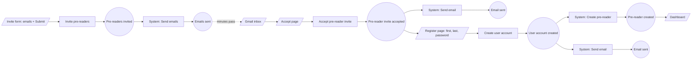
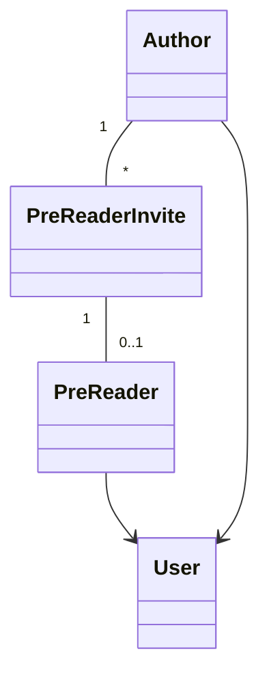

# Lesson 70 — Demo: FeedBook — Refining the Process Model with More Clarity (Views & State Changes)
- **Source file:** 70) Demo FeedBook — Refining the Process Model with More Clarity (Views & State Changes).txt
- **Category:** theoretical-ddd
- **Topics:** event-storming, event-modeling, views, wireframes, input-output-data, state-changes, state-machines, idempotency, consistency, transactions, bounded-contexts, users-identity, author-vs-user, pre-reader-invite, emergent-design, domain-experts, FeedBook

## Summary
Khalil backs up to fill steps missed in the lesson 69 demo. When he started coding, details were missing, which is a case of emergent design. The fix is to walk the concrete example through **views (screens)**, attach them to the event storm, and then tally the **input and output data** of every command–event pair. That reveals which state to model and which state machines and transitions exist, and only then do you implement the domain model. The walk-through surfaces the missing **Users & Identity** work: how does an invited pre-reader log in again? This produces a new **Register** step and the chain PreReaderInvite accepted → User account created → Pre-reader created. The design principle is one state change at a time, within one context at a time, linked by events. This gives **idempotency** and consistency and avoids multi-change transactions. It also surfaces the relationship **Author – PreReaderInvite – PreReader**, with both Author and PreReader related to User.

## Core ideas
- This is the emergent design process: the earlier demo missed steps, so recalibrate.
- Flow recap: problem guess point → domain knowledge → subdomains. Moving to the solution guess point, you **must bring a concrete example / story** (the design story may be general and broad at the top). Without it, "it's very easy to miss details."
- The main idea of the whole course is **abstraction**: start from the *what* and get clearer and clearer until you reach the *how*.
- The concrete example (restated): *Inviting pre-readers to the platform — only one out of the three invites were accepted.* Given I'm an author, already on the platform, book uploaded, no pre-readers invited. When I invite three pre-readers in bulk, they get an email. When Sally accepts, I get an email that Sally accepted, Sally has a pre-reader account, and James and Bill have unaccepted invites ([transcript: "accepted invites"]).
- A story is still relatively abstract. The best way to visualize it is **wireframes / screens**, which make it feel real and capture more details.
- **Author vs User**: an author belongs to the **FeedBook** subdomain. A user belongs to the generic **Users & Identity** subdomain/context. Applications usually need to balance work between the two contexts.
- Order the work across contexts so the steps connect via **events**. This gives **idempotency**: "your system could fail any of these steps and you could bring it back up and you know that your system is going to be in a consistent state."
- Doing 3–4 state changes at once requires a transaction wrapping them all, which is hard. The goal is "state changes that are happening one step at a time within one subdomain or one context at a time."
- The missing clarity: work that must happen in the Users context was never mapped, because the concrete example wasn't walked through well enough.
- **Next steps (the refined method)**:
  1. Complete the event storm by adding **views**.
  2. Identify the **input and output data** of each command–event pair.
  3. This tells you **which types of state** need modelling.
  4. With more certainty (from walking the experience), identify the **state machines and their transitions**.
  5. Finally, implement the **domain model**.
- Walking the views surfaced open questions: username? first name, last name? password? How will they log in again after accepting? Auto-generate a password and ask them to change it at next login, or ask right away?
- "These are all things that will get missed if you don't do the problem space correctly." If you build from scratch, map your screens. If they're not mapped, the gaps will still surface when you implement the domain model, as they did for Khalil.
- At a company where stories arrive with exact screens, many guesses have already been made. Still, question whether something is missing. "That's why it's called problem, solution and architecture guess points. These are all guesses."
- Resolution path: go back to the **domain experts** ("Oh, I didn't think about that"), or have a **designer** draw an alternate experience. Chosen answer: after clicking Accept, go to a **Register** screen (username/password, first/last name), then the **Dashboard**. They'll be asked for a password immediately after accepting.
- Views are linked through the event storm: **Gmail** → app accept page → register → dashboard. Khalil gave the views different URL names ("this could be different").
- Before registering, the invitee is "almost like a guest", not fully a pre-reader yet.
- Dependency: you can't create the pre-reader until a user account exists, "because this relies on that." You "should know this from our context mapping" (the Users link wasn't drawn earlier).
- Navigation to the dashboard isn't modelled as an event because nothing state-changing happens there. "It's good to know."
- Need clarity as early as possible: a solid example/user story, UX, wireframes, mock-ups, actual screens. The experience "will dictate what moves to change and in what sequence… it's going to dictate the state machine."
- Email content matters: what exactly will the email say? The accept link must carry the **pre-reader invite ID** so the system knows who's accepting.
- Temporal layout: stickies are moved down to show what happens immediately after (System reactions) versus later (the user acting after minutes pass).

## Named frameworks / mental models
- **Refined process-model pipeline**: Concrete example → Event storm + **views** → **input/output data per command–event pair** → state types → **state machines and transitions** → domain model implementation.
  - Purpose: reach the *how* with enough clarity to model state correctly.
  - When: solution guess point, before coding the domain model.
- **One state change per step, per context, linked by events** → idempotency and consistency without big transactions.
- **Views as event-storm anchors** (screens linked to commands and events, similar to event modeling).
- **Guess points are guesses**: expect missing details and keep questioning even polished specs.
- **Abstraction from what → how.**

## Definitions
- **Idempotency** (as defined here) — the system could fail at any step, be brought back up, and still be in a consistent state.
- **Author** — FeedBook (core) concept. **User** — generic Users & Identity concept.
- **Pre-reader invite** — the aggregate made of author ID + invited email, with state accepted / not accepted. It connects Author to Pre-reader.
- **Application rule** — required input data that isn't a domain invariant but is needed to operate, e.g. authorId (to connect back to the author) or preReaderInviteId (to know who's accepting).
- **Aggregate rules** — Khalil's label for the data requirements listed on an aggregate (author ID, email).

## Rules & heuristics
- Never move from problem to solution without a concrete example in a clear format.
- Use wireframes/screens to catch missing details and link them to the event storm.
- Tally input and output data for every command–event pair.
- Model state changes one at a time, in one context at a time, connected via events. Avoid multi-change transactions.
- Put cross-context work in the right order: the user account must exist before the pre-reader is created.
- Don't model navigation that causes no state change (e.g. redirect to dashboard).
- When the walk-through raises questions, take them back to domain experts or designers rather than guessing.
- Question even pre-made stories and screens.
- Carry identifiers in events and emails (preReaderInviteId in the link) so later commands can find the aggregate.
- Visually position System reactions right under their triggering events to show timing.

## Anti-patterns / mistakes called out
- Moving to the solution space without a concrete, visualized example, which causes missed details (e.g. login, passwords).
- Not mapping work in the generic Users context.
- Wrapping several state changes across concepts in one transaction.
- Assuming given user stories or screens are complete.
- Trying to create the pre-reader before the user account exists.

## Code discussed
No code written. Data requirements derived (for later implementation):

### Command/event data tally
| View | Actor | Command | Input data | Event | Output / notes | Context |
|---|---|---|---|---|---|---|
| Invite form (enter emails, dropdown/list, Submit) | Author | Invite pre-readers | list of pre-reader invites: `authorId`, `email` (many) | Pre-readers invited | carries details for email incl. `preReaderInviteId` | FeedBook |
| — | System (listens) | Send email(s) | invite details, `preReaderInviteId` templated into link | Email(s) sent | several emails | Email (external service; we implement event-handling code) |
| Gmail inbox → app accept page ("so-and-so is inviting you to become a pre-reader for this book") | Invitee (guest-like) | Accept pre-reader invite | `preReaderInviteId` (application rule) | Pre-reader invite accepted | — | FeedBook |
| — | System (immediately) | Send email | — (may call a service) | Email sent | email that the invite was accepted (spoken as "letting Sally know"; the story says the author is notified) | Email |
| Register page | Invitee | Create user account | first name, last name, password (email already known, not asked; later listed "first name, last name, password, email") | User account created | Users also subscribes to the invite-accepted event | Users & Identity |
| — | System | Create pre-reader | valid invite must exist; user account | Pre-reader created | last step | FeedBook |
| — | System | Send email | — | Email sent | at the same time as pre-reader creation | Email |
| Dashboard | — | (none) | — | (none) | not modelled; no state change | — |

### Aggregate: PreReaderInvite
```ts
// reconstructed from narration
type PreReaderInviteStatus = 'notAccepted' | 'accepted'; // initial: notAccepted

interface PreReaderInvite {
  id: string;        // preReaderInviteId, templated into the email link
  authorId: string;  // application rule / relationship back to Author
  email: string;     // invitee email
  status: PreReaderInviteStatus;
}

// command inputs
type InvitePreReadersInput = { authorId: string; email: string }[];
type AcceptPreReaderInviteInput = { preReaderInviteId: string };
type CreateUserAccountInput = { firstName: string; lastName: string; password: string; email: string };
```

### Relationships that emerged
| Concept | Related to | Via / note |
|---|---|---|
| Pre-reader | Author | through PreReaderInvite |
| Pre-reader | User | pre-reader requires a user account |
| Author | User | also related |
| Author, PreReaderInvite, PreReader | — | "three different pieces of state… they can all change in different ways" |

## Diagrams / visual models described
- **Guess-point map** with the problem guess point (domain knowledge → subdomains), then the solution guess point with a concrete example / design story at the top.
- **Views** drawn above the event storm: invite form (email inputs + Submit), a gear emoji for the System, Gmail inbox, app accept page (Accept button), register page (first/last name, password, Submit), dashboard. Each is linked by arrows to its command.
- **Relationship sketch**: Author — PreReaderInvite — PreReader, with PreReader → User and Author → User.
- **Temporal layout**: System reactions are placed directly under their triggering events. User-driven steps appear later, after minutes pass.
- Mermaid sketches (reconstructed):



## Notable quotes
- "It's very easy to miss details if we don't actually have a concrete example of what it is we're trying to build."
- "Your system could fail any of these steps and you could bring it back up and you know that your system is going to be in a consistent state."
- "Design out state changes that are happening one step at a time within one subdomain or one context at a time."
- "That's why it's called problem, solution and architecture guess points. These are all guesses."
- "Even if someone else has done this work… do question and do continue to question that things might be missing."
- "You can't create a pre-reader account until you have a user account for them."
- "It will dictate what moves to change and in what sequence. And it's going to dictate the state machine."

## Cross-references
- Lesson 69 (initial event storm) is refined here.
- Lesson 22 (Domain Discovery: event modeling as inputs/outputs/state changes).
- Lesson 16 (Vertical Slicing), Lesson 18 (Temporal Decoupling).
- Lesson 71 (Architecture Guess Point), Lesson 72 (moving to the physical).
- Lessons 74 and 76 (state machines), Lesson 77 (implementing the PreReaderInvite domain object).

## Fluff skipped
The garbled, unrelated speech-to-text at the end ("refrigerator", "animals", "menjadi fervent").

## AI-era relevance hint
- Agents fill spec gaps silently (e.g. inventing a password flow). Walking views and tallying input/output data exposes these gaps before code exists.
- "One state change per context per step, linked by events" is an architectural constraint to state explicitly to agents so they don't generate brittle multi-aggregate transactions.
- Explicit IDs in events and emails and a clear order of cross-context steps make generated handlers verifiable and idempotent.

## Coverage proof
- Lines read: 134 / 134
- Final line (verbatim): "You're in general. Very good with all the animals. menjadi fervent."
