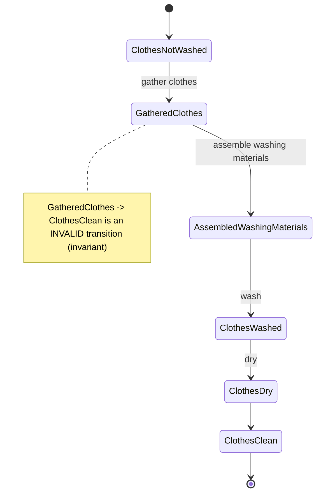

# Lesson 74 — Discussion: Understanding State Machines, Invariants, Transitions, Events & The Role of the Stateful Guess Point
- **Source file:** 74) Discussion Understanding State Machines, Invariants, Transitions, Events & The Role of the Stateful Guess Point.txt
- **Category:** theoretical-ddd
- **Topics:** stateful-guess-point, state-machines, invariants, transitions, events, initial-state, business-logic, encapsulation, stateless-vs-stateful, thinking-backwards, programming-paradigms, invalid-state

## Summary
Khalil introduces the stateful guess point: after stateless FA²STR problems (data in → data out), real-world problems are stateful. Using a hand-washing-clothes example built by starting from the end state, he introduces states, transitions, events, invalid transitions, and invariants (rules = business logic). States and events are two sides of the same coin; every transition produces an event. Encapsulation's purpose is to protect how the model changes, so the system can never be put into an invalid state. An elevator assignment is teased.

## Core ideas
- Students must be able to **design and piece together state machines** and understand **invariants**.
- Invariants are where **business logic and rules** enter; so far, stateless FA²STR work only transformed data using the input/output model (e.g. palindrome: "mom" in → result out).
- Stateless = "feedback loop level one" (the stateless level). Stateless problems just look at/transform data — not that helpful alone, because in the real world "problems are stateful."
- Washing clothes (by hand) example — built by **starting from the end**:
  - Start: clothes not washed. Goal: clothes clean.
  - Students proposed: gather clothes, separate colors, put in detergent (machine-assumed; separating colors not really needed by hand).
  - Working backwards: clothes clean (last) ← clothes dry ← clothes washed ← assemble washing materials ← … ← gathered clothes.
  - "You see what happens when you start from the end? … It's the technique."
- Difference from stateless: there are **states in the middle** you can be in; each state is itself data.
  - Input: clothes to be washed; output: washed/clean clothes.
- **Transitions feel functional because they are functional** — whether you write OO or functional code, this is the functional part of the program. "Paradigm doesn't matter" (future lesson topic: programming paradigms).
- Topics of this guess point: invariants, transitions, events, initial state — "all about state."
- Every move from one state to the next is a **transition**; every transition creates an **event** (e.g. `GatheredClothes`).
- **States and events are two sides of the same** thing: state = where we are; event = data saying "we just moved to this state."
- Humans must do each step manually → hence washing machines, which move through states with **rules at each state**.
- **Invalid transition**: gathered clothes → clothes clean is not allowed. Enforcing that rule in a system = **invariants**.
- **Invariant = rule = business logic.**
- **Purpose of encapsulation: to protect the way the model changes.** E.g. if the machine is `new`, calling `dryClothes()` makes no sense — the system must not allow it. "Harden this concept."
- The stateful guess point is where we begin to **solve problems in the world** — introducing state; but introducing state requires ensuring it changes correctly, at the right time, never at the wrong time.
- Real-world invalid-state examples: blowing into your Nintendo, restarting your router, Uber Eats purchase interrupted by a phone call → accidentally buying McDonald's.
- Upcoming: an **elevator** state-machine assignment.

## Named frameworks / mental models
- **Stateless vs stateful guess point**
  - Stateless (level one): input/output data transformation.
  - Stateful (level two): state machines with invariants; where real problems get solved.
- **State machine model** — components: initial state, states, transitions, events, invariants (valid/invalid transitions). Use: modelling any domain object whose data changes over time.
- **Start from the end (thinking backwards)** — define final state first, then derive preceding states.
- **Paradigm-agnostic transitions** — transitions are functions regardless of OO/FP.

## Definitions
- **Invariant** — a rule, which really equals business logic; enforced to prevent invalid transitions.
- **State** — a position the system can be in; being at a state is a form of data.
- **Transition** — moving from one state to the next.
- **Event** — a piece of data representing "we just moved to this state"; created on every transition; named after it (e.g. gathered clothes).
- **Invalid transition** — a move between states the rules disallow (e.g. gathered clothes → clothes clean).
- **Encapsulation (purpose)** — to protect the way the model changes.

## Rules & heuristics
- Model the end state first, then work backwards to the start.
- Every state change should go through a named transition that emits an event.
- Guard every operation against being called in the wrong state; the system must never enter an invalid state.
- Don't obsess over OO vs FP — the transition logic is functional either way.

## Anti-patterns / mistakes called out
- Allowing operations at the wrong time (e.g. `dryClothes` on a new/empty machine).
- Letting state change at the wrong time → Nintendo/router/Uber Eats–style glitches.
- Staying only at stateless data transformation — not enough to solve real problems.

## Code discussed
- Narrated only: "imagine this was now some code… if it's new, should I be able to say dry clothes?" — the model must reject it.
```ts
// reconstructed from narration (class/state names inferred)
type LaundryState =
  | 'new'
  | 'gatheredClothes'
  | 'assembledWashingMaterials'
  | 'clothesWashed'
  | 'clothesDry'
  | 'clothesClean';

class Laundry {
  private state: LaundryState = 'new';

  dryClothes() {
    // invariant: can only dry clothes that have been washed
    if (this.state !== 'clothesWashed') {
      throw new Error(`Invalid transition from ${this.state} to clothesDry`);
    }
    this.state = 'clothesDry';
    // emit ClothesDried event (inferred)
  }
}
```

## Diagrams / visual models described
- Stateless I/O: data in → system → data out (palindrome "mom").
- Washing clothes state machine (ordering of early states partly inferred):

- Events labelled on each transition; states and events drawn as the same nodes ("these are also states").

## Notable quotes
- "Invariance equals a rule, which really equals business logic."
- "In the real world, we're always dealing with statefulness. Problems are stateful."
- "You see what happens when you start from the end? I'm telling you. It's the technique."
- "Every single time we do a transition, we get something called an event created."
- "What is the purpose of encapsulation? To protect the way the model changes."
- "You don't want to be able to put the system in an invalid state."
- "Recognize the paradigm doesn't matter."

## Cross-references
- Lesson 52 (FA²STR at the stateless guess point), Lessons 49–50 (palindrome).
- Lesson 51 (AAA backwards / wishful thinking), Lesson 75 (Thinking Backwards).
- Lesson 76 (Visualizing state machines on FeedBook), Lesson 77 (PreReaderInvite domain object), Lesson 78 (fixtures/builders for stateful tests).
- Lesson 18 (Temporal Decoupling — events).

## Fluff skipped
Lines ~9–13 are garbled STT (mixed-language nonsense) — skipped; privilege/"my mom" jokes, 1912 washboard banter.

## AI-era relevance hint
- Agents generate setters freely; defining invariants and valid transitions is the human's job to keep systems out of invalid states.
- An explicit state diagram is a compact spec an agent can implement and a reviewer can check transition-by-transition.

## Coverage proof
- Lines read: 55 / 55
- Final line (verbatim): "that's one of my favorite words around this time to say. There's an elevator assignment I want you all to try out. Tim, I'm glad it was help."
