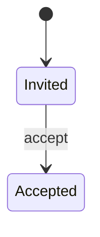
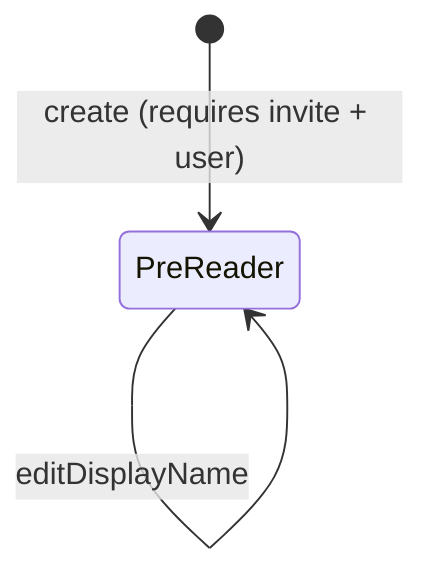
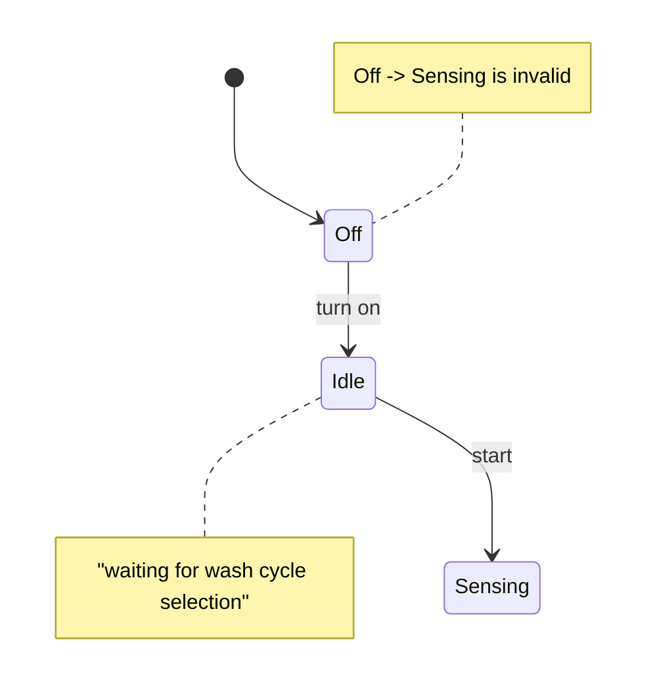

# Lesson 76 — Demo: FeedBook — Visualizing State Machines
- **Source file:** 76) Demo FeedBook — Visualizing State Machines.txt
- **Category:** theoretical-ddd
- **Topics:** feedbook, state-machines, pre-reader-invite, pre-reader, domain-modelling, sequence-of-creation, generic-subdomain, invariants, creation-validation, display-name, washing-machine

## Summary
Khalil walks the FeedBook flow statefully, tallying every piece of state that changes: pre-reader invite, email (external/generic), user, and pre-reader, plus the pre-existing author. He derives the sequence of creation (author → pre-reader invite → user → pre-reader) and chooses to model the pre-reader invite and pre-reader. A domain model encapsulates data, rules, processes, and relationships; a state machine clarifies how an object may change over time. The pre-reader invite is simple (Invited → Accepted via `accept`); the pre-reader has little state change, so its complexity lies in valid creation — he adds a display-name rule for demonstration and contrasts with a richer washing-machine state machine.

## Core ideas
- Walk through the flow and watch state change step by step; **tally everything that changes** and model each.
- Four pieces of state in the system:
  - **Pre-reader invite** (managed by us)
  - **Email** (external — part of a generic subdomain; not managed by us)
  - **User**
  - **Pre-reader** (managed by us)
- Creating a pre-reader relies on a pre-reader invite and a user (inferred from "one of these and one of these").
- **Author** was created way ahead of time; emails get created all over the place.
- **Sequence of creation**: author → pre-reader invite → user → pre-reader.
- Model individually; focus on pre-reader invite and pre-reader (both to be coded next).
- A domain model must encapsulate: **data, rules, processes, relationships**.
- A **state machine** gets clear on the rules for how a thing can change over time — do this first.
- PreReaderInvite: initial state `Invited`; other state `Accepted` (considered "active"; "accepted makes more sense"); transition `accept`.
- PreReader: "not a whole lot of change"; rules are mostly what's necessary to **create** it → more about relationships and data.
- Complexity for these two is in **creation**: passing in all the correct pieces and ensuring they **cannot be created without** those things (validation).
- Added demo behavior: pre-reader can **edit display name**.
  - On join: display name = combination of first name and last name.
  - Rule (as narrated, somewhat fuzzy): first name lowercased + hyphen + last name lowercased, maybe 10 characters; he also mentions possibly taking some of the last characters of the last name.
- Everything depends on domain knowledge and what you're supposed to build.

## Named frameworks / mental models
- **Tally state changes → model each piece** — walk the process model, list every entity whose state changes, mark managed vs external.
- **Sequence of creation** — temporal dependency ordering of entities.
- **Domain model encapsulation checklist**: data, rules, processes, relationships.
- **State machine per domain object** — initial state, states, transitions; use before coding to clarify rules.

## Definitions
- **Sequence of creation** — the order in which pieces of state must come to exist (author → invite → user → pre-reader).
- **Domain model (what it encapsulates)** — data, rules, processes, relationships.

## Rules & heuristics
- Model state machines before writing domain-object code.
- Separate state you manage from external/generic state (e.g. email).
- If an object has few transitions, focus rigor on creation validation.
- Invalid transitions must be impossible (e.g. washing machine can't go Off → Sensing).

## Anti-patterns / mistakes called out
None explicitly.

## Code discussed
- No code yet (next lesson builds the domain models). Shapes implied:
```ts
// reconstructed from narration (names inferred)
type PreReaderInviteState = 'invited' | 'accepted';

class PreReaderInvite {
  private state: PreReaderInviteState = 'invited';
  accept() {
    this.state = 'accepted';
  }
}

// display-name rule (approximate; narration is fuzzy)
function defaultDisplayName(firstName: string, lastName: string): string {
  return `${firstName.toLowerCase()}-${lastName.toLowerCase()}`.slice(0, 10); // 10-char limit (inferred)
}
```

## Diagrams / visual models described
- Temporal flow: author → pre-reader invite → user → pre-reader, with emails emitted along the way.
- PreReaderInvite state machine:

- PreReader state machine (minimal):

- Washing machine (richer example):


## Notable quotes
- "These are the four pieces of state that we have in our system at this point in time."
- "A pre-reader can only really come to be if an author is there first, then a pre-reader invite is there, and then a user exists."
- "We need the data. We need the rules. We need the processes and we need the relationships."
- "We can use a state machine to get clear on the rules on how this thing can change over time."
- "Make sure that they can't be created without those things."

## Cross-references
- Lessons 69–70 (FeedBook event storming & refined process model).
- Lesson 74 (state machines, invariants), Lesson 77 (Implementing the PreReaderInvite domain object), Lesson 78 (fixtures/builders).
- Lesson 23 (Strategic Design — generic subdomains).

## Fluff skipped
None significant.

## AI-era relevance hint
- Listing managed vs external state and the creation sequence gives agents a precise, reviewable domain spec.
- Humans must decide which invariants exist (e.g. no pre-reader without invite + user); agents won't infer business rules.

## Coverage proof
- Lines read: 38 / 38
- Final line (verbatim): "finally get into the part of this where we can now build out these domain models."
