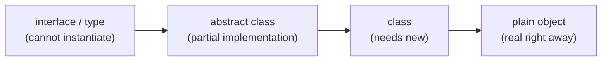

# Lesson 79 — Understanding Abstraction & Levels of Realness: Interfaces, Abstract Classes & Concretions
- **Source file:** 79) Understanding Abstraction & Levels of Realness Interfaces, Abstract Classes & Concretions.txt
- **Category:** abstraction-oop
- **Topics:** abstraction, interfaces, abstract-classes, concretions, contracts, responsibility-driven-design, roles, actors, responsibilities, collaborations, levels-of-realness, traffic-light, object-calisthenics, react-component, typescript-types, decoupling-from-infrastructure

## Summary
Prompted by a student who extracted an unnecessary interface for a traffic light, Khalil explains a "spectrum of realness" from most abstract (interfaces/types — can never be instantiated) through abstract classes (partially real) to classes and plain objects (most real). Through a responsibility-driven lens, interfaces describe roles (a job description); actors fill roles; a contract is an actor playing a role (`implements`/`extends`). Using the Broadway-play analogy (Three Little Pigs, George Clooney), he argues abstraction is only needed when multiple actors can play a role — a role only one actor can ever play ("George Clooney'd") needs no interface. This mental model is key for decoupling from infrastructure in upper guess points.

## Core ideas
- Common struggle: when to use interfaces, abstract classes, concretions; what a **contract** is.
- **Spectrum of realness**: from not real (interfaces) to completely real (concretions).
- Interfaces describe the **concept / role** — pure abstract idea of what something should be.
  - Analogy: a **job application/description** exists before anyone fills the job.
- **Role** is an RDD topic; RDD = deepest layer of craftship, the "responsibility first" way to reason.
- Programming with contracts is what allows **decoupling from infrastructure** in upper-layer guess points.
- Context: student just did object calisthenics; next comes the responsibility-driven part, all under the major idea of abstraction & design.
- Student's approach: built `TrafficLight` concretion first, then extracted an interface as a public API (refactoring technique). Student's view: interface = contract with required signatures a client/dependency must implement.
- Khalil: only one actor would ever play the traffic-light role — the traffic light itself → **no contract needed**. If another actor might play it (swap out), then contract it.
- Job description (marketer) with responsibilities; actors (Sam, Bill, Khalil) can play one or many roles. Assigning responsibilities to a role inadvertently creates a contract.
- "I can't get more abstract than a contract and it can't get more real than an actor."
- **Abstraction is the root principle of design**: expressing what we want without defining everything; highlight what's essential, remove what's not.
- When to go from real → abstract: the moment someone else could play the role — e.g. a traffic light on planet Mars, a **model train traffic light** (lights stay on longer). Then the contract gets **triangulated** and more essential: required stuff in the contract, implementation details in the concretion.
- With only one implementation built up, contract and concretion are "one and the same" → no separation needed.
- Terms to master next section: **actors, roles, responsibilities, collaborations, contracts**.
- **Contract = an actor playing a role.** `implements` creates the contract ("we're going to play this role now"); can be multiple; can also happen with `extends`.
- **Broadway play** (Three Little Pigs): roles = big bad wolf, pig 1–3; collaborations = interactions in scenes; responsibilities = e.g. "make house out of bricks." All abstract until actors (George Clooney, Brad Pitt, Tina Fey — Tina Fey as the big bad wolf) play them; any actor could play any role.
  - Roles side = declarative "what should happen"; actors side = implementation "what actually happens."
  - **George Clooney cameo** written into the play as himself → only George Clooney can play it → no abstraction. Student's traffic light: "You George Clooney'd it."
- RRC (roles, responsibilities, collaborations) doesn't map to a specific programming construct — a role can be implemented with a class, object, interface, abstract class. What matters is the **intended level of abstraction** of the concept (George Clooney: real right away; Pig 2: must be abstract so other actors can play it).
- Levels of realness (programming constructs):
  - **Most abstract** (can never be real, can't instantiate): `interface` (e.g. `UserRepository` with `save`, `getById`); TypeScript `type` — same level.
  - **Middle**: `abstract class` — some implementation (e.g. standardized `getById`) plus abstract methods you must implement. Better example: **React component** — must implement `render` returning JSX/component; many other methods (e.g. detect changes) implemented behind the scenes.
  - **Real**: `class` — needs `new`; acts as a blueprint, so slightly less real than a plain object.
  - **Most real**: plain object literal — real right away.
- **Only make something abstract when multiple different actors can play that role.**
- `TrafficLightProps`: used as a structural tool — shorthand describing the shape of a plain object; could be a class (information holder), but it's really just about typing (avoids getters/setters boilerplate). Fine.
- Student notes also mention Liskov substitution ("[Let's go off substitution]").

## Named frameworks / mental models
- **Spectrum of realness** — most abstract (interface/type) → abstract class → class → plain object (most real). Use to pick the construct matching a concept's intended level of abstraction.
- **RDD vocabulary** — actors, roles, responsibilities, collaborations, contracts.
- **Job description analogy** — role/contract exists independent of who fills it.
- **Broadway play analogy** — roles vs actors; declarative vs implementation.
- **George Clooney test** — if only one actor can ever play the role, don't abstract it.
- **Triangulating the contract** — when a second actor appears, move essentials into the contract and details into concretions.

## Definitions
- **Interface** — description of what a particular role should do; pure abstract concept; cannot be instantiated.
- **Role** — a job to be played (RDD); abstract until an actor plays it.
- **Actor** — the real thing that plays one or many roles.
- **Responsibility** — what a role must do (e.g. make house out of bricks).
- **Collaboration** — interactions between roles (who talks to whom).
- **Contract** — an actor playing a role; created by `implements` (or `extends`).
- **Abstraction** — root principle of design: expressing what we want without everything defined; highlighting the essential, removing the unnecessary.
- **Abstract class** — right in the middle of real and not: partial implementation + abstract members to implement.
- **Concretion** — fully implemented class/object.

## Rules & heuristics
- Default to a concretion; introduce an interface only when a second actor could play the role (or you intend to swap it out).
- Choose constructs based on the concept's intended level of abstraction, not habit.
- Use interfaces/contracts for infrastructure seams (repositories) to decouple.
- Types/interfaces for props-shaped plain objects are fine as a typing shorthand.

## Anti-patterns / mistakes called out
- Extracting an interface for something only one actor will ever play (the traffic light) — needless separation.
- Confusing interface extraction as a mere "public API" declaration without a role motivation.

## Code discussed
- Student: `TrafficLight` concretion with many methods, then an extracted interface as its public API; `TrafficLightProps` type for construction.
```ts
// reconstructed from narration
// Most abstract — cannot be instantiated
interface UserRepository {
  save(user: User): Promise<void>;
  getById(id: string): Promise<User | null>;
}
// TypeScript type — same level of abstractness
type UserRepositoryShape = {
  save(user: User): Promise<void>;
  getById(id: string): Promise<User | null>;
};

// Middle — partial implementation + abstract members
abstract class Repository<T> {
  async getById(id: string): Promise<T | null> {
    /* standardized implementation */ return null;
  }
  abstract save(entity: T): Promise<void>;
}

// Middle — React analogy (class components): must implement render
// abstract render(): JSX.Element;  // other lifecycle/change-detection methods implemented behind the scenes

// Real — class needs `new` (blueprint)
class User {
  constructor(public name: string) {}
}
const user = new User('Khalil');

// Most real — plain object
const plainUser = { name: 'Khalil' };
```
```ts
// reconstructed from narration — traffic light guidance
// Before (student): interface ITrafficLight + class TrafficLight implements ITrafficLight
// After (Khalil): just class TrafficLight — only one actor plays the role.
// Only add an interface when e.g. MarsTrafficLight or ModelTrainTrafficLight appears.
```

## Diagrams / visual models described
- Job description (contract/role: marketer, with responsibilities) ← actors Sam, Bill, Khalil.
- Broadway play: roles (big bad wolf, pig 1–3) with collaboration lines and responsibilities on the abstract side; actors (George Clooney, Brad Pitt, Tina Fey) on the real side.
- Spectrum axis: most abstract (left) → most real (right):


## Notable quotes
- "Interfaces are just a pure abstract conceptual idea of what it is that something should be."
- "I can't get more abstract than a contract and it can't get more real than an actor."
- "Abstraction is pretty much the root principle of design."
- "Who else is going to play the role of George Clooney other than George Clooney?"
- "You George Clooney'd it."
- "You only really need to make something abstract when there's going to be … different actors [that] can play that role."
- "What matters … is the intended level of abstraction for this concept."

## Cross-references
- Lesson 14 (Essential Abstraction — abstraction layers), Lesson 38 (How Will I Learn RDD), Lesson 36 (How Much OOP), Lesson 19 (Composition).
- Lesson 73 (fake implementing an interface — actor playing two roles).
- Lesson 17 (Horizontal Decoupling — decoupling from infrastructure via contracts).

## Fluff skipped
Coffee/recording backstory, "beaten that horse to death," fumbling for React method names, cut-off at end.

## AI-era relevance hint
- Agents over-produce interfaces and abstractions; the "George Clooney test" is a quick review heuristic to strip needless indirection.
- Knowing where real seams belong (infra contracts) lets you direct agents to abstract the right things and keep the rest concrete.

## Coverage proof
- Lines read: 131 / 131
- Final line (verbatim): "I'm going to cut the video right here."
